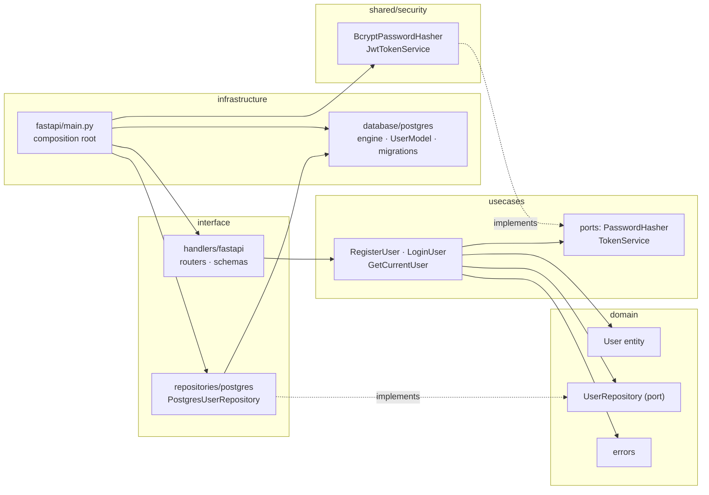
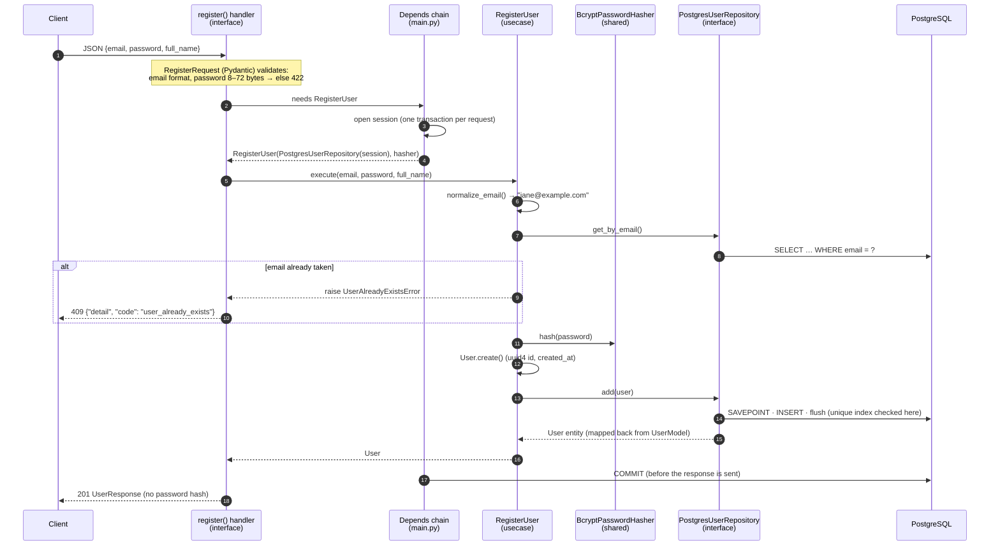

# Python Clean Architecture — FastAPI + React

User registration and JWT authentication, built with Clean Architecture.

This project is a Python rewrite of the Go template
[golang-clean-code-architecture](https://github.com/max38/golang-clean-code-architecture)
(GoFiber + GORM + PostgreSQL). It keeps the same layer names and the same feature
(register, log in, read your own profile) and adds a React front end.

| Part | Stack |
|---|---|
| Backend | Python 3.12 · FastAPI · SQLAlchemy 2.1 · Alembic · PostgreSQL 15 · bcrypt · PyJWT |
| Frontend | React 19 · TypeScript (strict) · Vite · React Router |
| Tooling | uv · Ruff · pytest · Vitest + Testing Library · Docker Compose |

---

## 1. Quick start

You need Docker with Compose v2.

```bash
cp .env.example .env
```

Set `JWT_SECRET` in `.env`. It is empty on purpose, so the stack will not start until you set it. You can generate one with:

```bash
python -c "import secrets; print(secrets.token_urlsafe(48))"
```

Then start everything:

```bash
docker compose up -d --build
```

| URL | What |
|---|---|
| http://localhost:5173 | Web app: register, log in, profile, log out |
| http://localhost:8000/docs | Interactive API docs (Swagger UI) |
| http://localhost:8000/health | Liveness probe |

The backend container runs `alembic upgrade head` before it starts serving, so the
schema is created automatically. `docker compose down` stops everything and keeps the
data. `docker compose down -v` also deletes the database volume.

### Running without Docker (development)

The database still runs in Docker. Backend and frontend run on the host with hot reload.
If the full stack is already up, run `docker compose stop backend frontend` first so the
ports are free.

```bash
docker compose up -d db
```

Backend (all backend commands run from `backend/`):

```bash
cd backend
uv sync
uv run alembic upgrade head
uv run uvicorn src.infrastructure.fastapi.main:create_app --factory --reload
```

The backend reads the same `.env` at the repository root. Its `DATABASE_URL` points at
`localhost:5433`, which is the port Compose publishes for Postgres.

Frontend, in a second terminal:

```bash
cd frontend
cp .env.example .env
npm ci
npm run dev
```

### Tests and checks

| Command (run from `backend/`) | What it does |
|---|---|
| `uv run pytest` | All 178 backend tests. Integration and API tests need `docker compose up -d db`; without it they are skipped with a message. |
| `uv run pytest -m "not integration"` | The 129 tests that need no database |
| `uv run pytest --cov=src --cov-report=term-missing` | Coverage (99%) |
| `uv run ruff check .` and `uv run ruff format --check .` | Lint and formatting |
| `uv run alembic revision --autogenerate -m "describe change"` | New migration from model changes. Read the generated file before applying it. |
| `uv run alembic downgrade -1` | Roll back the last migration |

| Command (run from `frontend/`) | What it does |
|---|---|
| `npm test` | 68 tests (Vitest + Testing Library, `fetch` is faked) |
| `npm run lint` | Oxlint, including a rule that bans `any` |
| `npm run build` | Type-check (`tsc`) and production build |

Integration tests use a separate database, `<POSTGRES_DB>_test`. It is created and
migrated automatically, and every test runs inside a transaction that is rolled back.
Your development data is never touched.

---

## 2. Project structure

```text
.
├─ backend/
│  ├─ src/
│  │  ├─ config/                    settings from environment (pydantic-settings)
│  │  ├─ domain/                    ── innermost: standard library only
│  │  │  ├─ entities/user.py        User entity (dataclass) + email normalisation
│  │  │  ├─ repositories/           UserRepository port (ABC)
│  │  │  └─ errors.py               business errors (no HTTP codes)
│  │  ├─ usecases/                  ── application rules
│  │  │  ├─ register_user.py · login_user.py · get_current_user.py
│  │  │  └─ ports/                  PasswordHasher, TokenService (ABC)
│  │  ├─ interface/                 ── adapters
│  │  │  ├─ handlers/fastapi/       routers, Pydantic schemas, dependencies, error mapping
│  │  │  └─ repositories/postgres/  SQLAlchemy UserRepository + entity/model mapper
│  │  ├─ infrastructure/            ── frameworks and drivers
│  │  │  ├─ database/postgres/      engine, session, ORM model, Alembic migrations
│  │  │  └─ fastapi/main.py         app factory = composition root (all wiring)
│  │  └─ shared/security/           bcrypt and JWT implementations of the ports
│  ├─ tests/{unit,integration,api}/
│  ├─ Dockerfile · alembic.ini · pyproject.toml · uv.lock
├─ frontend/
│  ├─ src/
│  │  ├─ api/                       typed fetch client, ApiError, token storage
│  │  ├─ features/auth/             AuthProvider/useAuth, form validation, error messages
│  │  ├─ pages/                     Login, Register, Profile, Home, NotFound
│  │  ├─ routes/                    route table, ProtectedRoute, safe redirects
│  │  └─ config.ts                  the only place that reads VITE_* variables
│  ├─ Dockerfile · docker/nginx.conf
├─ docker-compose.yml               db + backend + frontend
└─ .env.example
```

| Layer | Responsibility | Depends on | Example |
|---|---|---|---|
| **domain** | Business concepts and rules that hold no matter how the app is delivered | nothing (standard library) | `User.create()` normalises the email; `UserRepository` declares what storage must offer |
| **usecases** | One application action per class, coordinating entities and ports | domain | `LoginUser.execute()` looks up the user, verifies the password, checks the account is active, issues a token |
| **interface** | Converts between the outside world and the use cases | usecases, domain | HTTP JSON → `RegisterRequest` → `RegisterUser`; `User` ↔ `UserModel` |
| **infrastructure** | Concrete frameworks, drivers and the wiring | everything | SQLAlchemy engine, Alembic, `create_app()` |
| **shared/security** | Library-backed implementations of the security ports | usecase ports | `BcryptPasswordHasher`, `JwtTokenService` |

---

## 3. The dependency rule

Source-code dependencies point **inwards only**. Inner layers declare interfaces
(*ports*) and outer layers implement them (*adapters*). This is dependency inversion.



How the rule is kept, not just stated:

- `tests/unit/test_architecture.py` parses every file in `domain/` and `usecases/` with
  `ast`. The test fails if any of them imports something other than the standard library
  or an inner layer.
- The same test forbids HTTP handlers from importing SQLAlchemy, the Postgres repository,
  the security implementations or the settings. Handlers only see use cases.
- `src/infrastructure/fastapi/main.py` is the **only** module that imports from every
  layer. It reads the settings once and builds the engine, hasher, token service and use
  cases. It then binds the HTTP layer's dependency contracts (`provide_register_user`,
  ...) with `app.dependency_overrides`. `tests/unit/test_wiring.py` fails if a contract
  is left unbound.

---

## 4. One request end to end: `POST /api/auth/register`



Things to notice:

- The handler has no `if` that encodes a business rule and no `try/except`. Domain errors
  are turned into HTTP responses in one place
  (`interface/handlers/fastapi/errors.py`).
- `RegisterUser` neither knows nor cares that the request came over HTTP or that
  storage is PostgreSQL. Its unit tests run against an in-memory fake in milliseconds.
- `UserResponse` lists its fields explicitly, so `hashed_password` cannot leak into a
  response even by accident.

### API summary

| Method | Path | Success | Errors |
|---|---|---|---|
| `POST` | `/api/auth/register` | `201` user | `409` email taken · `422` invalid input |
| `POST` | `/api/auth/login` | `200` `{access_token, token_type: "bearer"}` | `401` invalid credentials · `403` inactive account · `422` |
| `GET` | `/api/users/me` (Bearer token) | `200` user | `401` missing/invalid/expired token or deleted account · `403` inactive account |
| `GET` | `/health` | `200` `{status: "ok"}` | – |

Every domain error has the same shape: `{"detail": "...", "code": "..."}`. Clients branch
on `code` instead of parsing messages. Validation errors keep FastAPI's standard `422` body.

---

## 5. Go → Python mapping

| Go template | This project | Notes |
|---|---|---|
| GoFiber | **FastAPI** | Async-capable, but the endpoints are plain `def` (see trade-offs) |
| GORM | **SQLAlchemy 2.x** (typed `Mapped[...]`) | Unit of work per request; repository maps to and from entities |
| `go run …/migration/main.go` (AutoMigrate) | **Alembic** (`alembic upgrade head`) | Versioned, reviewable, reversible migrations |
| koanf + `.env` | **pydantic-settings** | Typed and validated at startup (fail fast) |
| `interface` in `domain/repositories` | **`abc.ABC`** | See trade-offs for ABC vs `Protocol` |
| swag comments → `swagger.json` | **FastAPI OpenAPI** | Generated from type hints and schemas, so it cannot drift |
| `golang.org/x/crypto/bcrypt` | **bcrypt** | Behind the `PasswordHasher` port |
| `golang-jwt/jwt` | **PyJWT** | Behind the `TokenService` port |
| `go test` | **pytest** + Testing Library on the front end | |

**Why FastAPI.** Request validation, response filtering and OpenAPI docs all come from
the same type hints, so the HTTP layer stays small. Its `Depends` system is a built-in
dependency-injection container. That is what lets the composition root wire use cases and
lets tests swap any piece without touching production code.

**Why SQLAlchemy 2 + Alembic.** It is the most widely used and most capable ORM in
Python. The 2.x typed API works with static checking. Its Session is a proper unit of
work, which lets the request decide when to commit. Alembic gives versioned migrations
with `downgrade()`, where GORM's AutoMigrate cannot remove or rename anything safely.

### Where this version deliberately differs from the template

| In the Go template | Here | Why |
|---|---|---|
| Entities carry `gorm` tags; `UserModel` lives in `domain/models` | Plain `@dataclass` entity; ORM model in infrastructure plus a mapper | The domain must not depend on the ORM |
| `request.go` (domain) and the use case call bcrypt directly | `PasswordHasher` / `TokenService` ports, injected | Algorithms can be swapped, and use cases can be tested without slow hashing |
| JWT code reads the global config on every call | Secret and expiry are passed to the constructor once | No hidden global state; settings are read only in the composition root |
| Repository returns raw GORM errors; duplicate email → `500` | `IntegrityError` on the email index → `UserAlreadyExistsError` → `409` | Callers see business errors; storage details stay inside the adapter |
| "Email not found" and "wrong password" give different errors | Same error, same message, similar response time | Prevents user enumeration (see trade-offs) |
| CORS `AllowOrigins: "*"` | Explicit origins from `CORS_ORIGINS`; `*` is rejected | Least privilege |
| Login stores tokens in a `user_tokens` table | Stateless access token only | Smaller scope; revocation is listed under next steps |

---

## 6. Testing strategy

```text
            ┌───────────────┐   api (34)              HTTP contract through the real app factory:
            │      api      │                         status codes, JSON shape, headers, CORS
          ┌─┴───────────────┴─┐ integration (24)      repository contract (fake + Postgres),
          │    integration    │                       migrations, Postgres-specific behaviour
      ┌───┴───────────────────┴───┐ unit (120)        entities, use cases with fakes, security,
      │           unit            │                   settings, mapper, error mapping, architecture
      └───────────────────────────┘
```

| Level | What it proves | How |
|---|---|---|
| **Unit** | Business rules: duplicate emails (any case), wrong password vs unknown email give the same error, inactive accounts, token tampering, expiry and `alg=none` | Use cases receive `FakeUserRepository`, a fake hasher and a fake token service (`tests/fakes.py`). No Docker. |
| **Contract** | The fake behaves like the real repository | `test_user_repository_contract.py` runs one set of tests against **both** the fake and PostgreSQL |
| **Integration** | Mapper round-trip, unique index → domain error, savepoint keeps the transaction usable, repository never commits, migrations match the models and downgrade cleanly | Dedicated `_test` database, migrated with Alembic, one rolled-back transaction per test |
| **API** | Every endpoint and every status code it can return, `WWW-Authenticate` headers, CORS preflight, secrets never logged | `TestClient` on the real `create_app()`; requests join the test transaction; bcrypt cost lowered via `dependency_overrides` |
| **Guards** | The architecture keeps its shape | Import rules (`test_architecture.py`), every domain error has an HTTP mapping, every DI contract is wired |
| **Frontend** | API client error handling, 401 → sign-out, auth state, form validation, keyboard-only use, redirects back after login, no open redirect | Vitest + Testing Library with a faked `fetch` |

Tests were also checked against deliberate bugs. For example, mapping `409` to `400` or
removing the request-level `commit()` makes the suite fail.

---

## 7. Design decisions and trade-offs

**Abstract base classes rather than `Protocol` for ports.** `class PostgresUserRepository(UserRepository)`
states the relationship in the code. An implementation that misses a method fails as
soon as it is instantiated, not later when the method is called. `Protocol` gives
structural typing without inheritance, but the link between port and adapter would be
invisible to a reader. ABCs are used consistently for every port.

**Who commits the transaction.** Repositories only `add` + `flush`. Flushing makes the
database check the unique index right away. A savepoint means a failed insert does not
poison the transaction. The request-scoped `get_session` dependency commits on success
and rolls back on any error, so every write in a use case succeeds or fails together. The
dependency is declared with `scope="function"`. With FastAPI's default scope, the code
after `yield` runs after the response has been sent. A client could then receive `201`
before the commit happened, or even when the commit failed. This was confirmed with a
failing-commit experiment before it was relied on.

**Synchronous endpoints.** The expensive step is bcrypt, which is CPU-bound and gains
nothing from `async`. FastAPI runs plain `def` endpoints in a thread pool. Sync
SQLAlchemy keeps the code and tests simpler, and it matches the Go original.

**UUID ids generated in the domain.** `User.create()` assigns a `uuid4`. An entity is
complete before it is saved, so the fake repository needs no sequence. Ids cannot be
enumerated (`/users/1`, `/users/2`, …).

**Email normalisation and uniqueness.** Emails are trimmed and lower-cased by the
entity. The use case checks for duplicates before hashing, which gives a clear error and
skips bcrypt. A unique index is the final guard against two concurrent sign-ups.

**User enumeration.** Unknown email and wrong password raise the same
`InvalidCredentialsError`. For an unknown email the use case still verifies the password
against a dummy bcrypt hash, so both cases take the same time (measured at about 225 ms
each with cost 12). Account status (`403 inactive`) is only revealed after a correct
password.

**JWT is stateless.** Tokens carry only `sub`, `type`, `iat` and `exp`. The payload is
signed, not encrypted. The accepted algorithm is pinned, which rejects `alg=none` and
algorithm-confusion attacks, and the secret length is validated per algorithm. The cost:
a token cannot be revoked before it expires. Logging out only deletes the token in the
browser. This is mitigated by short-lived tokens (30 minutes), re-checking `is_active` on
every `/users/me`, and a 401 anywhere signing the client out.

**Token storage: `localStorage`.** Simple, survives reloads, and works with the
`Authorization` header. Any script on the page could read it, so an XSS bug would expose
the token. An `httpOnly` cookie would hide it from JavaScript but needs CSRF protection
and backend changes. React's escaping, the absence of `dangerouslySetInnerHTML`, and
short token lifetimes keep the risk acceptable for this scope.

**Calling the API cross-origin with CORS, not through a dev proxy.** Development then
behaves like production, where the static site and the API are on different origins.
Origins are listed explicitly, `*` is rejected, and `allow_credentials` is off. Tokens
travel in a header, not a cookie, so credentials mode is not needed.

**ORM model location.** As the task required, `UserModel` lives in
`infrastructure/database/postgres` and the repository adapter in
`interface/repositories/postgres` imports it. That is one arrow from *interface* to
*infrastructure*, the same as in the Go template. Both files are Postgres details. The
rule that matters most still holds and is tested: domain and use cases never see
SQLAlchemy. Moving `models/` next to the adapter would make the rule strict.

**Validation in two places.** The browser checks the same limits as the API for instant
feedback. That includes the password limit, counted in UTF-8 bytes because bcrypt stops
at 72 bytes and a Thai character is 3 bytes. The API (Pydantic + use cases) remains the
authority.

---

## 8. What I would improve next

- **Refresh tokens and revocation.** Short access tokens plus rotating refresh tokens,
  stored server-side so logout and "sign out everywhere" really revoke access.
- **`httpOnly` + `SameSite` cookies.** Move tokens out of JavaScript's reach, with CSRF
  protection.
- **Rate limiting and lockout.** Throttle `/api/auth/login` per IP and per account to
  slow down credential stuffing.
- **Structured logging.** JSON logs with a request id that is propagated to the response,
  plus metrics for login failures.
- **CI pipeline.** Run Ruff, pytest (with a Postgres service), the frontend tests and the
  Docker builds on every push.
- **End-to-end browser tests.** For example Playwright, running against the Compose stack.
- **Account lifecycle.** Email verification, password reset, a stronger password policy
  with a breached-password check, and an admin action to deactivate users.
- **Runtime response validation on the client.** For example zod, so a backend contract
  change fails loudly instead of being trusted by a type assertion.
- **Generic CRUD.** Mirror the Go template's `crudModels.go` with a
  `GenericRepository[T]` / use case, so new entities need no new plumbing.
